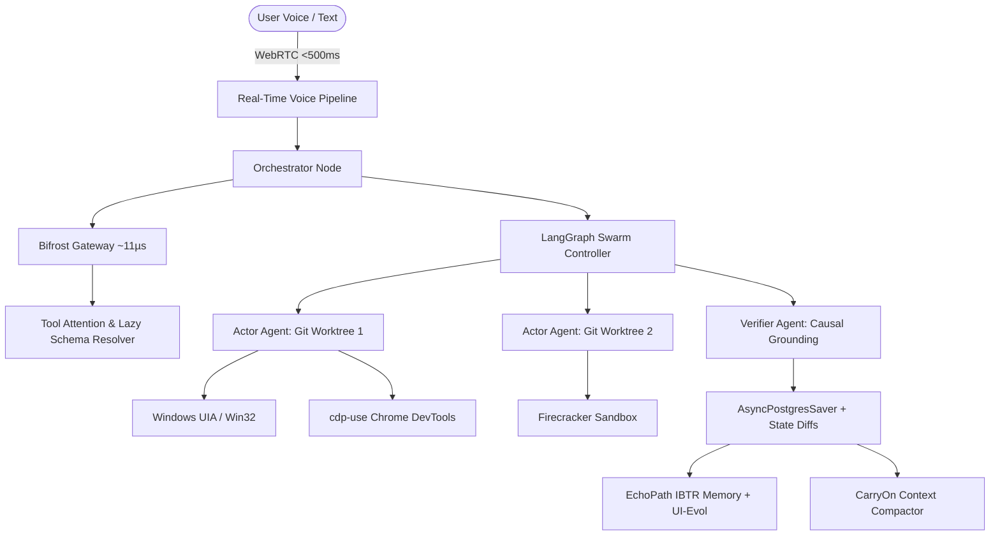

# AutogenOS

<p align="center">
  
</p>

<p align="center">
  <strong>Autonomous Multi-Agent Operating System Framework with Recursive Self-Improvement</strong>
</p>

<p align="center">
  <a href="#core-architecture">Architecture</a> •
  <a href="#key-pillars">Key Pillars</a> •
  <a href="#quickstart">Quickstart</a> •
  <a href="#academic-foundations">Academic Foundations</a> •
  <a href="#repository-layout">Repository Layout</a>
</p>

---

## Overview

**AutogenOS** is an autonomous operating system control framework designed to orchestrate massively parallel, multi-agent swarms across **Windows, Linux, and macOS**. It bridges real-time multimodal perception, cross-platform OS automation, and recursive self-improvement while eliminating context bloat and generative hallucination.



---

## Key Pillars

### 1. High-Speed Function-Calling & Execution Library
- **Tool Attention**: Semantic tool gating using dense vector similarity (`all-MiniLM-L6-v2`) over tool metadata pool, reducing token overhead by up to 95%.
- **Progressive Disclosure**: Markdown-driven `SKILLS.md` loaded lazily with strict `allowed-tools` scopes.
- **Code Execution with MCP**: Replaces chatty multi-turn JSON calling loops with single-pass Python/Bash program synthesis inside isolated sandboxes.
- **Bifrost High-Performance Gateway**: Sub-11µs proxy overhead with dual-layer semantic caching.

### 2. System Full Control Architecture
- **Cross-Platform OS Automation**: Native introspection and input injection via Windows UI Automation & Win32, Linux X11/AT-SPI, and macOS Accessibility APIs.
- **Swarm Concurrency via Git Worktrees**: Isolated subagent workspaces on separate worktrees preventing filesystem collisions.
- **Pure CDP Browser Automation**: Fast WebSocket JSON-RPC communication via `cdp-use` without heavy headless browser abstractions.
- **Sub-500ms Continuous Voice Loop**: WebRTC streaming powered by LiveKit Agents SDK, Silero VAD, ONNX TurnDetector v1-mini, and EMA dynamic endpointing.

### 3. Academic Foundations & Recursive Self-Improvement
- **RSIAgent**: Broad-then-deep autonomous exploration during idle compute cycles.
- **StructAgent & SolveBind**: Strict Planner-Actor-Verifier causal transitions gated by deterministic environment evidence.
- **EchoPath & UI-Evol**: Execution-level replay graphs via Image-based Target-Reaiming (IBTR) and automated telemetry critique.
- **CarryOn**: Object-oriented context folding compressing long trajectories into active state representations.
- **OSWorld 2.0 & Agent-Diff**: Rigorous state-diff evaluation against exact database and filesystem mutations.

---

## Repository Layout

```
AutogenOS/
├── papers/
│   ├── 01_rsi_agent_broad_deep_exploration.md          # RSIAgent theoretical whitepaper
│   ├── 02_eliminating_the_mcp_tax_tool_attention.md    # Tool Attention & MCP Tax whitepaper
│   ├── 03_struct_agent_deterministic_causal_evidence.md# StructAgent & SolveBind whitepaper
│   ├── 04_echopath_ui_evol_execution_replay.md         # EchoPath IBTR & UI-Evol whitepaper
│   └── 05_carryon_object_oriented_context_compaction.md# CarryOn context compaction whitepaper
├── autogenos/
│   ├── api/
│   │   └── server.py              # High-performance FastAPI REST & WebSocket server
│   ├── components/
│   │   ├── local_whisper.py       # 100% free offline STT via faster-whisper
│   │   ├── local_tts.py           # 100% free zero-latency TTS (Windows SAPI5/offline)
│   │   ├── livekit_local.py       # Free local LiveKit room & WebRTC server
│   │   ├── screen_vision.py       # PIL ImageGrab & perceptual dHash grounding
│   │   ├── vector_search.py       # TF-IDF & dense semantic vector retrieval
│   │   ├── terminal_runner.py     # Real-time streaming CLI with RTK compression
│   │   └── browser_automation.py  # Chrome/Edge launcher with remote debugging
│   ├── core/
│   │   ├── orchestrator.py        # Central Router & Graph Orchestration
│   │   ├── prompt_protocol.py     # Master Operational Contract & Directives
│   │   └── state.py               # Typed State & Causal Evidence
│   ├── tool_attention/
│   │   ├── engine.py              # Semantic Tool Gating & Cosine Matcher
│   │   ├── registry.py            # Lazy Schema & Tool Metadata Store
│   │   └── token_killer.py        # RTK Terminal Output Compressor
│   ├── skills/
│   │   └── progressive_loader.py  # SKILLS.md Parser & Allowed-Tools Scoper
│   ├── execution/
│   │   ├── code_runner.py         # Single-pass Code-as-Policy MCP runner
│   │   ├── sandbox.py             # Ephemeral process sandbox
│   │   └── worktree_manager.py    # Isolated Git Worktree Concurrency
│   ├── control/
│   │   ├── base.py                # Abstract OS controller interface
│   │   ├── windows_bridge.py      # Win32 / UI Automation Native Bridge
│   │   ├── linux_bridge.py        # Linux X11 / AT-SPI D-Bus Bridge
│   │   ├── mac_bridge.py          # macOS Accessibility Bridge
│   │   ├── os_controller.py       # Cross-platform auto-detecting facade
│   │   └── cdp_browser.py         # Pure WebSocket CDP Browser Controller
│   ├── voice/
│   │   ├── turn_detector.py       # Silero VAD + TurnDetector v1-mini + EMA
│   │   └── voice_agent.py         # Sub-500ms WebRTC voice agent with barge-in
│   ├── swarm/
│   │   ├── graph.py               # LangGraph state machine with failure attribution
│   │   └── postgres_saver.py      # Thread-scoped durable state checkpointer
│   ├── memory/
│   │   ├── carryon.py             # Context Compactor & Task Folder
│   │   ├── echopath.py            # IBTR Replayable Memory Graph
│   │   ├── ui_evol.py             # UI-Evol Retrace & Critique knowledge adapter
│   │   └── struct_verifier.py     # Causal Verification Engine & Evidence Gating
│   ├── gateway/
│   │   └── bifrost_client.py      # Ultra-low-latency Gateway Proxy Client
│   ├── self_improvement/
│   │   └── rsi_agent.py           # RSIAgent Broad-then-Deep exploration engine
│   └── eval/
│       ├── agent_diff.py          # State-Diff Verification Engine
│       └── osworld_runner.py      # OSWorld 2.0 evaluation workflow harness
├── tests/                         # 35 comprehensive unit & integration tests
├── pyproject.toml
└── README.md
```

---

## Quickstart

### Installation

```bash
# Clone the repository
git clone https://github.com/autogenos/autogenos.git
cd autogenos

# Install dependencies
pip install -e .

# Optional: Windows UI Automation dependencies
pip install -e .[windows]
```

### Basic Usage

```python
import asyncio
from autogenos.core.orchestrator import SwarmOrchestrator
from autogenos.tool_attention.engine import ToolAttentionEngine
from autogenos.tool_attention.registry import ToolMetadata

async def main():
    # 1. Initialize Tool Attention Registry
    engine = ToolAttentionEngine()
    engine.register_tool(ToolMetadata(
        name="win_launch_app",
        summary="Launch Windows application via Win32 ShellExecute",
        schema={"type": "object", "properties": {"app_name": {"type": "string"}}},
        tags=["os", "windows", "launch"]
    ))
    
    # 2. Gate tools for incoming user intent
    active_tools = engine.gate_tools("Open calculator and compute hashes", top_k=2)
    print(f"Promoted tools ({len(active_tools)}): {[t.name for t in active_tools]}")

    # 3. Instantiate Orchestrator
    orchestrator = SwarmOrchestrator()
    result = await orchestrator.dispatch_intent("Open Notepad and verify process ID")
    print(f"Result: {result}")

if __name__ == "__main__":
    asyncio.run(main())
```

---

## License

Apache-2.0 License. See `LICENSE` for details.
