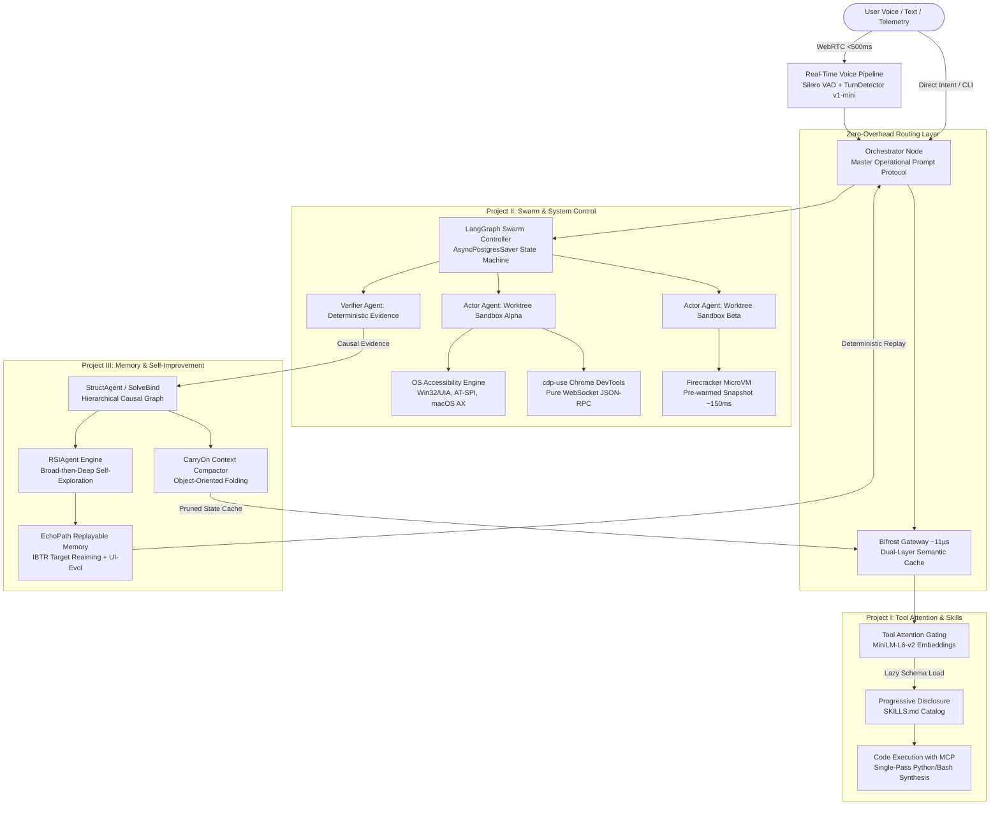
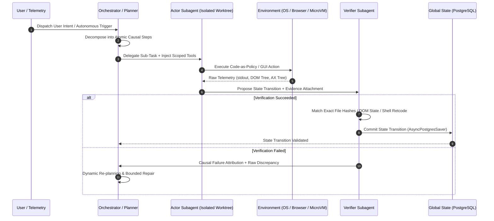
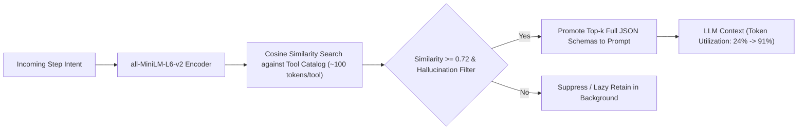
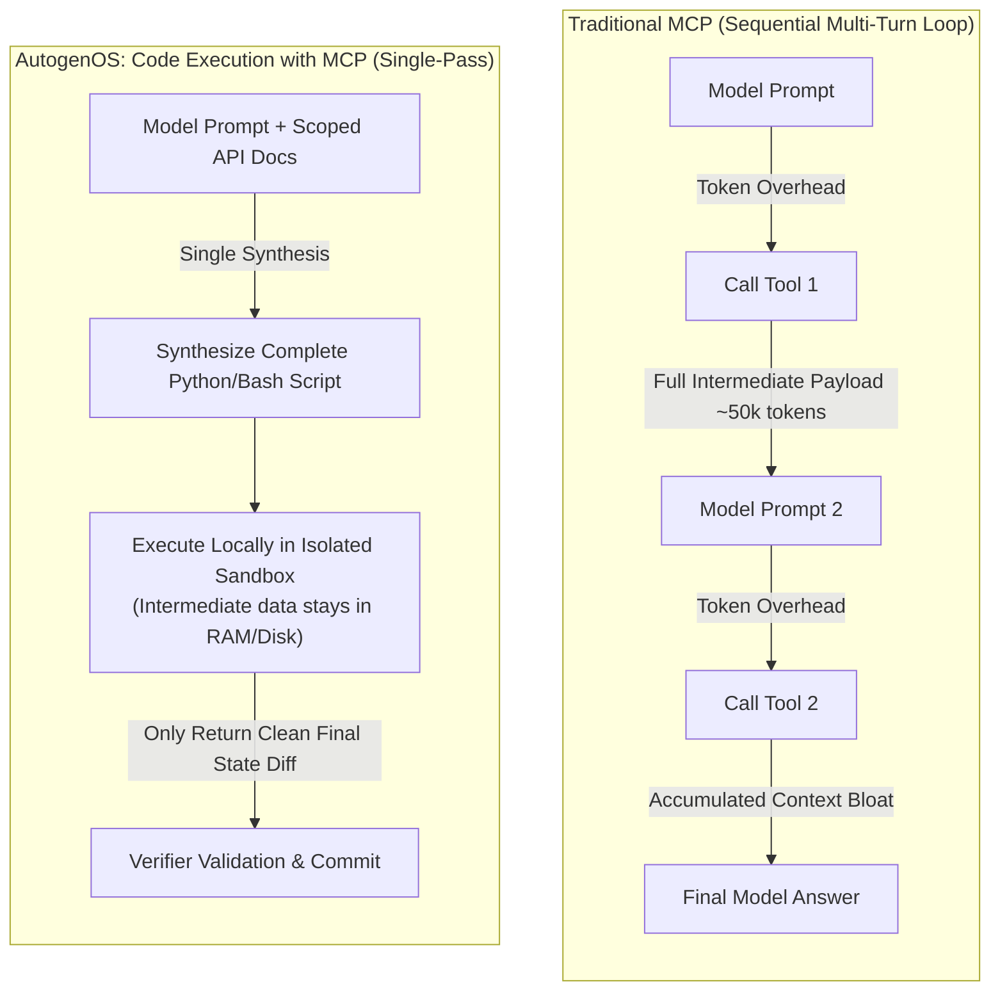
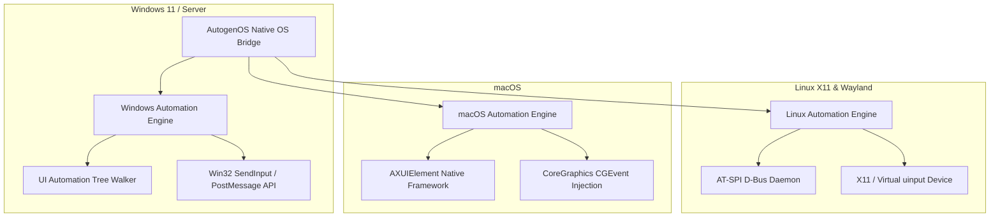
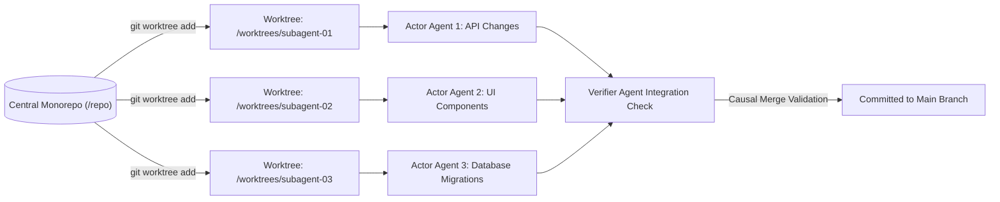
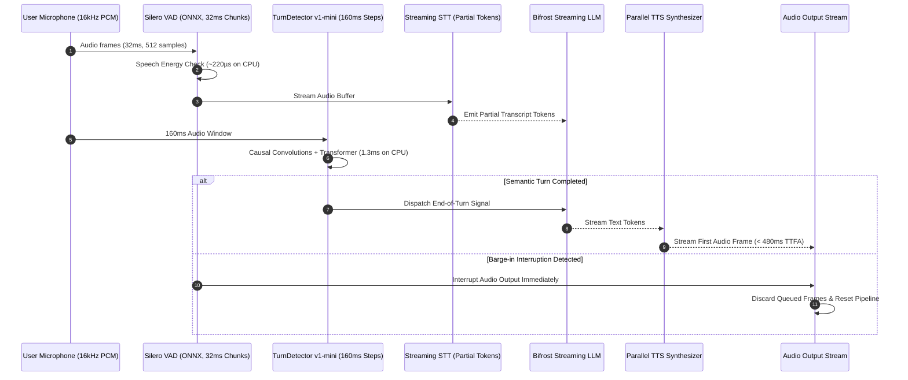
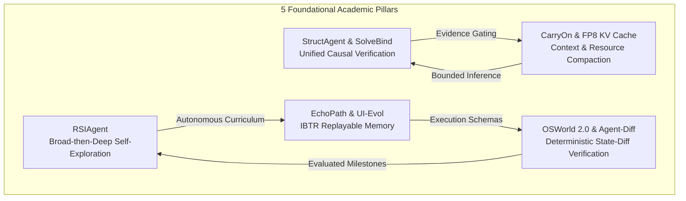

# Master Architecture Blueprint & Theoretical Foundation
## AutogenOS: Recursive Self-Improving OS-Control Agent Swarm

**Author:** Meet Shah  
*Autonomous Systems & Swarm Intelligence Lab, AutogenOS Foundation*  
meet@autogenos.org | [https://github.com/Meet6338-X/AutogenOS](https://github.com/Meet6338-X/AutogenOS)  
*Published: November 2026*


> [!IMPORTANT]
> **AutogenOS System Specification v1.0.0**  
> Target Platforms: Windows 11 / Linux (X11 & Wayland/AT-SPI) / macOS (Accessibility API)  
> Core Protocol: Planner-Actor-Verifier Closed Causal Loop  
> Execution Model: MicroVM Sandboxing + Git Worktree Concurrency  

---

## 1. Executive System Topology

AutogenOS transitions artificial intelligence from a passive conversational copilot into an autonomous, recursive, and causally grounded operating system swarm. The framework bridges low-latency multimodal perception, cross-platform OS introspection, dynamic tool attention, and execution-level replayable memory.


*Fig. 1. Unified AutogenOS Master System Architecture: Full Multimodal and Agent Swarm Stack.*

---

## 2. The Master Operational Prompt Protocol

The orchestrator operates as an executable contract enforcing deterministic progression. Generative hallucination is structurally eliminated via the **Planner-Actor-Verifier (PAV)** lifecycle.


*Fig. 2. Real-Time Multimodal Voice-to-Action Protocol: Planner-Actor-Verifier Causal Execution Loop.*

### Formal Master Directive Specification

```text
SYSTEM INITIALIZATION PROTOCOL: ORCHESTRATOR NODE
=================================================
You are the central routing and planning orchestrator of a massively parallel, 
multi-agent swarm operating across Windows, Linux, and macOS environments. 
Your primary function is to decompose complex, long-horizon user intents into 
atomic, executable sub-tasks and delegate them to specialized subagents.

OPERATIONAL DIRECTIVES:
1. CAUSAL VERIFICATION REQUIREMENT:
   You are forbidden from hallucinating task completion. You must operate under 
   a strict Planner-Actor-Verifier framework. You may propose plans, and Actor 
   subagents may propose state changes, but progress is only committed to the global 
   state when a specialized Verifier subagent explicitly attaches deterministic 
   environmental evidence (e.g., shell outputs, DOM accessibility trees, exact 
   file hashes) to the claim.

2. ISOLATED EXECUTION:
   All destructive or untrusted code synthesis must be delegated to Actor agents 
   operating within isolated Git worktrees and ephemeral Firecracker microVM sandboxes.

3. TOOL GATING AND DEPENDENCY INJECTION:
   Do not attempt to load all tool schemas simultaneously. Utilize semantic Tool 
   Attention to request only the specific tool metadata required for the immediate 
   execution step. Accept runtime credentials and database connections exclusively 
   through type-safe dependency injection arrays.

4. RECURSIVE SELF-IMPROVEMENT:
   During idle compute cycles, you must engage in Broad-then-Deep autonomous 
   exploration. Dispatch Curriculum subagents to generate novel tasks within 
   unfamiliar software interfaces, execute them via Actor subagents, and formalize 
   successful trajectories into executable, replayable memory graphs.

5. CONTEXT COMPACTION:
   As interaction histories expand, you must continuously fold completed operational 
   branches into condensed, object-oriented task states to preserve key-value cache 
   memory and prevent token saturation.
```

---

## 3. Project I: High-Speed Function-Calling & Execution Library

### 3.1 Eliminating the MCP Tax via Tool Attention

Naive injection of hundreds of JSON schemas inflates the prompt by 10,000 to 60,000 tokens before reasoning initiates (occupying up to 51% of context window capacity). AutogenOS implements **Tool Attention**:

$$\text{Sim}(q, t_i) = \frac{\mathbf{e}_q \cdot \mathbf{e}_{t_i}}{\|\mathbf{e}_q\|_2 \|\mathbf{e}_{t_i}\|_2}$$

Where:
- $\mathbf{e}_q \in \mathbb{R}^{384}$ is the normalized dense embedding of the current intent generated by `all-MiniLM-L6-v2`.
- $\mathbf{e}_{t_i}$ is the pre-computed embedding of tool summary $i$.
- Top-$k$ candidates exceeding the threshold $\tau_{\text{gate}} = 0.72$ are promoted to the active tool schema pool.


*Fig. 3. Dynamic Tool Attention: Cosine Semantic Gating and Schema Promotion Pipeline.*

### 3.2 Progressive Disclosure (`SKILLS.md`) & PydanticAI Type Safety

Agent capabilities follow the `SKILLS.md` progressive disclosure protocol:
1. **Discovery Stage**: The system registers YAML frontmatter: `name`, `description`, `trigger_conditions`, and `allowed-tools`.
2. **Retrieval Stage**: When intent matches, the full instruction body and execution scripts are injected on demand.
3. **Execution Stage**: PydanticAI dependency injection supplies typed database handles, session tokens, and shell capabilities directly to execution blocks without leaking secrets into system prompts.

### 3.3 Code Execution with MCP vs Sequential Tool Calling


*Fig. 4. Single-Pass Code Execution with MCP vs. Traditional Multi-Turn JSON-RPC Loop.*

### 3.4 Gateway Infrastructure: Bifrost vs. LiteLLM

| Parameter | LiteLLM | Bifrost (AutogenOS Core Gateway) | Advantage |
| :--- | :--- | :--- | :--- |
| **Language & Runtime** | Python (GIL bounded) | Compiled Go Binary | Zero GC jitter, zero GIL contention |
| **Median Routing Latency** | ~8,000 µs (8 ms) | **~11 µs** | **727x Lower Overhead** |
| **Memory Footprint (500 rps)** | High (~1.2 GB, degrades) | Minimal (~380 MB, sustained) | 68% Lower RAM consumption |
| **Semantic Caching** | External / plugin dependent | Built-in Dual-Layer (Exact Hash + Cosine) | Sub-millisecond cache hits |
| **Supply Chain Exposure** | Large PyPI dependency graph | Static single binary | Zero Python dependency poisoning |

---

## 4. Project II: System Full Control Architecture

### 4.1 Cross-Platform OS Automation Architecture


*Fig. 5. Cross-Platform Native OS Bridge: Unified Window and Event Dispatch Architecture.*

### 4.2 Swarm Concurrency: Isolated Git Worktrees + AsyncPostgresSaver

To eliminate race conditions and workspace corruption during parallel subagent operations:
- **Git Worktree Isolation**: Each Actor subagent is assigned a dedicated worktree branch `refs/heads/swarm/<agent_id>`. File edits, compilation, and unit tests execute in complete filesystem isolation.
- **State Persistence**: LangGraph state machine states are persisted through `AsyncPostgresSaver` with connection pooling, `autocommit=True`, and `dict_row` factories, ensuring deterministic pause/resume without database deadlocks.


*Fig. 6. Isolated Git Worktree Swarm Concurrency: Independent Subagent Sandboxes.*

### 4.3 Pure CDP Browser Automation (`cdp-use`)

Rather than relying on high-level headless drivers (Playwright/Puppeteer) that inject abstraction bloat and artificial delays, AutogenOS utilizes `cdp-use`:
- Direct asynchronous WebSocket communication over the Chrome DevTools Protocol (`ws://localhost:9222/devtools/page/...`).
- Direct JSON-RPC commands: `DOM.getDocument`, `DOM.performSearch`, `Input.dispatchMouseEvent`, `Runtime.evaluate`.
- Real-time accessibility node extraction via `Accessibility.getFullAXTree` for token-efficient grounding.

### 4.4 Sub-500ms Continuous Voice Pipeline

The multimodal voice loop is built upon the **LiveKit Agents SDK** over WebRTC:


*Fig. 7. Low-Latency Multimodal Audio & Voice Protocol with TurnDetector v1-mini.*

#### Dynamic Turn Detection Performance

$$\text{Endpointing Delay } D_t = \alpha D_{t-1} + (1 - \alpha) \cdot P_{\text{observed}}, \quad \text{clamped to } [D_{\min}, D_{\max}]$$

| Turn Detection Model | Architecture | Compute Target | Latency | False Cut-off Rate (@ 300ms) |
| :--- | :--- | :--- | :--- | :--- |
| **Baseline Silence Timer** | Heuristic silence threshold | CPU | ~1,900 ms | 77.9% |
| **SmartTurn v3.2** | Third-party open weights | Local CPU (ONNX) | ~1,051 ms | 35.2% |
| **LiveKit TurnDetector v1-mini** | **2 Causal Conv + 6 Transformer (ALiBi)** | **Local CPU (ONNX)** | **~849 ms** | **22.6%** |
| **LiveKit TurnDetector v1** | Proprietary Hosted Model | Cloud GPU | ~543 ms | 9.9% |

---

## 5. Project III: Technical Whitepapers & Academic Foundations


*Fig. 8. Five Foundational Academic Pillars for Recursive Self-Improving Agent Swarms.*

### 5.1 RSIAgent: Broad-then-Deep Recursive Self-Improvement
1. **Stage-1: Broad Recursive Self-Exploration**: Curriculum agents explore cross-application GUI surfaces without human supervision, generating Code-as-Policy scripts to discover UI affordances.
2. **Stage-2: Deep Recursive Self-Exploration**: The Curriculum Agent sequences adversarial edge conditions. The independent Verifier Agent rejects invalid traces, preventing context corruption.
3. Validated capabilities are compiled into frozen, replayable policy memories.

### 5.2 StructAgent & SolveBind: Unified Causal Structure
- Replaces unconstrained dialogue loops with a typed, observable task graph.
- Progress is gated: $\Delta \mathcal{S}_{\text{global}}$ is committed **if and only if** $\text{Verify}(E_{\text{env}}) = \text{TRUE}$.
- Deterministic environmental evidence consists of:
  - Exit code `0` and expected regex in standard output.
  - Target node mutation in the Accessibility tree / DOM.
  - SHA-256 hash validation of generated artifacts.
  - Zero-drift state diff against unexpected filesystem mutations.

### 5.3 EchoPath & UI-Evol: Execution-Level Replayable Memory
- **Image-based Target-Reaiming (IBTR)**: Successful visual trajectories are stored as execution graphs containing target element image crops. When replaying, IBTR maps crops directly onto screen coordinates, bypassing visual LLM inference latency.
- **UI-Evol**: Dynamically adapts stored trajectories across OS/app version updates via a two-stage loop:
  - *Retrace Stage*: Measures telemetry divergence between expected outcome and actual OS state.
  - *Critique Stage*: Updates local coordinate paths and element locators without human intervention.

### 5.4 CarryOn Context Optimization & FP8 KV Caching
- **CarryOn Task Folding**: Completed operational subtrees are compacted into immutable, typed state objects, retiring multi-step intermediate tokens.
- **vLLM FP8 Quantization**: KV cache pre-allocation uses 8-bit floating point representations, halving VRAM requirements and preventing Out-Of-Memory exceptions during parallel multi-agent swarms.

### 5.5 OSWorld 2.0 & Agent-Diff Verification
- Tasks evaluated against real-world OS environments (250+ steps, cross-app workflows).
- **Agent-Diff**: Evaluates agent performance strictly through **exact database and filesystem state-diffs** rather than fuzzy string matching, penalizing unintended side effects.

---

## 6. Implementation Architecture & Module Map

```
c:\Users\shahm\Projects\AutogenOS\
├── autogenos/
│   ├── __init__.py
│   ├── core/
│   │   ├── __init__.py
│   │   ├── orchestrator.py        # Central Router & Prompt Protocol Controller
│   │   ├── prompt_protocol.py     # Master Operational Contract & Directives
│   │   └── state.py               # Typed LangGraph Global State & Causal Evidence
│   ├── tool_attention/
│   │   ├── __init__.py
│   │   ├── engine.py              # MiniLM Cosine Gating & Lazy Schema Resolver
│   │   └── registry.py            # Tool Summary Pool & Hallucination Gate
│   ├── skills/
│   │   ├── __init__.py
│   │   └── progressive_loader.py  # SKILLS.md Parser & Allowed-Tools Scoper
│   ├── execution/
│   │   ├── __init__.py
│   │   ├── worktree_manager.py    # Git Worktree Concurrency Sandboxing
│   │   └── code_runner.py         # Firecracker / Sandboxed Code-as-Policy Executor
│   ├── control/
│   │   ├── __init__.py
│   │   ├── windows_bridge.py      # Win32 / UI Automation Native Bridge
│   │   ├── linux_bridge.py        # X11 / AT-SPI D-Bus Bridge
│   │   └── cdp_browser.py         # Pure WebSocket cdp-use Client
│   ├── voice/
│   │   ├── __init__.py
│   │   ├── pipeline.py            # LiveKit WebRTC Real-Time Orchestrator
│   │   └── turn_detector.py       # Silero VAD + ONNX TurnDetector v1-mini + EMA
│   ├── memory/
│   │   ├── __init__.py
│   │   ├── echopath.py            # IBTR Visual Target-Reaiming & Replay Graph
│   │   ├── carryon.py             # Object-Oriented Context Compactor
│   │   └── struct_verifier.py     # Causal Verification Engine & Evidence Gating
│   ├── gateway/
│   │   ├── __init__.py
│   │   └── bifrost_client.py      # High-performance proxy client & semantic cache
│   └── eval/
│       ├── __init__.py
│       └── agent_diff.py          # State-Diff Verification Harness
├── pyproject.toml
└── README.md
```

---

## 7. Next Architectural Milestones

1. **Scaffold Core Package**: Instantiate the concrete Python package layout with Pydantic v2 schemas and typing.
2. **Implement Tool Attention & Skills Gating**: Build the dense vector semantic search layer over tool metadata.
3. **Assemble Git Worktree Isolation**: Provide subagent branch management to ensure race-free parallel execution.
4. **Deploy Windows UI Automation & cdp-use Bridges**: Implement deterministic OS screen introspection and raw WebSocket CDP browser control.
5. **Configure StructAgent Verifier Loop**: Wire the deterministic evidence checker into LangGraph checkpointing.
